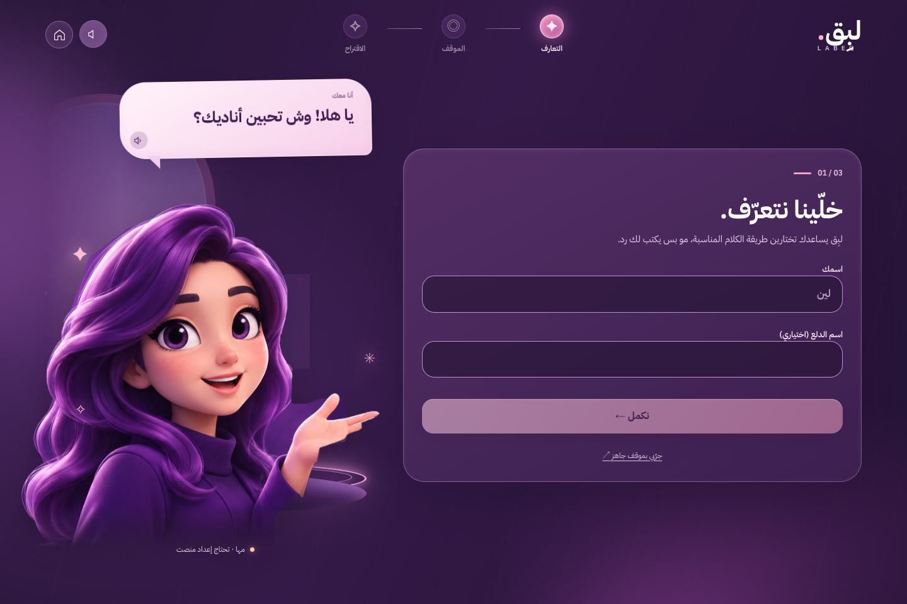
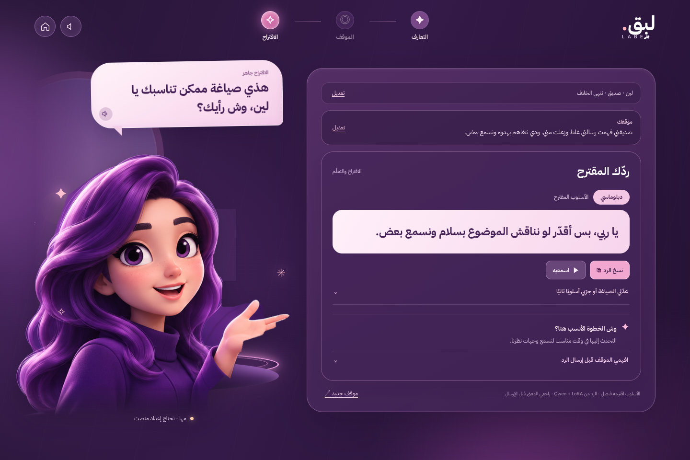
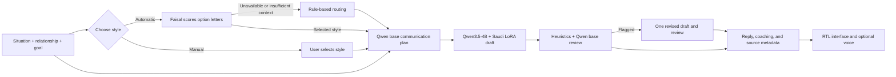

# LABEQ · لبِق

**A Saudi Arabic communication coach for deciding what to say, how to say it, and why it fits the situation.**

[](#tech-stack) [](#features) [](#model-architecture) [](#tech-stack) [](#tech-stack) [](#model-architecture) [](#run-locally) [](#voice-and-maha)

[Try the public demo](https://leenalaslani.github.io/Labeq/) · [العربية](README_AR.md) · [Training and evaluation](training/README.md) · [Model card](MODEL_CARD.md)

The public demo uses labeled examples and runs in the browser. The local V16 application integrates Qwen, Saudi LoRA, and optional Faisal routing through FastAPI.

## Why Saudi Arabic pragmatics matter

A message can be grammatically correct and miss the user's intent. «ما أقدر أساعدك اليوم» declines today's request. «ودي أساعدك بس ما أقدر أساعدك كل يوم وأنا عندي شغلي» communicates an ongoing boundary while acknowledging the relationship. The distinction is essential when proposing a reply for repeated requests, misunderstandings, or apologies.

LABEQ keeps the situation, relationship, and goal as separate inputs. Communication style changes how the message is expressed. Register is another control, with conversational Saudi Arabic for many personal exchanges and clear professional Arabic for work and customer interactions.

## Features

- Arabic RTL onboarding with relationship, preset or custom goals, and typed or dictated situations.
- Five communication styles with alternatives, formality controls, copy, and listen actions.
- Situation-specific coaching that shows the main issue, a suggested approach, and a risk to avoid. A style change can show two actual drafts side by side.
- Maha, a layered 2.5D character with the original expressions, eye movement, and speech animation.

## Screenshots

| Onboarding | Local model reply |
| --- | --- |
|  |  |

[Relationship](screenshots/release-relationship.png) · [Goal](screenshots/release-goal.png) · [Situation](screenshots/release-situation.png) · [Coaching](screenshots/release-coaching.png) · [Style comparison](screenshots/release-style-comparison.png) · [Mobile demo](screenshots/release-mobile-demo.png)

The local screenshots use real Qwen3.5-4B inference with the pilot Saudi LoRA. The mobile screenshot shows the GitHub Pages example mode.

## Model architecture



**Faisal decision routing.** Omer Nacar's Jev-inspired [ara-jev-Faisal](https://huggingface.co/Omartificial-Intelligence-Space/ara-jev-Faisal) is a Qwen3.5-4B decision model trained to choose among supplied options. LABEQ supplies a compact JSON decision task with the situation, relationship, goal, and six labeled options, including insufficient information. With thinking disabled, the router scores the next token over the option letters and takes the highest-scoring valid choice. LABEQ reports the actual source for each request. Faisal is distributed under CC BY-NC 4.0. Its published evaluation concerns the author's tasks, so LABEQ's style-routing quality needs its own benchmark.

**Saudi response generation.** [Qwen3.5-4B](https://huggingface.co/Qwen/Qwen3.5-4B) combines gated delta layers with periodic full attention and supports text and image input. LABEQ uses text. The base produces a compact communication plan, the Saudi LoRA generates a reply, and the base reviews the result against the same user goal. The first draft uses greedy decoding. A flagged draft can trigger one sampled rewrite and a fresh review. Role-aware prompts, repetition and intent checks, and visible quality flags help users review the draft before sending. These checks are heuristics and model judgments.

## Dataset and evaluation

The approved package contains 958 training examples, including 178 human-approved revisions and 780 unchanged synthetic examples. Two reviewed candidates were held out of training due to meaning risks. The validation and test splits each contain 114 examples. The 38-case review set takes one example per held-out scenario from the test split.

The [training and evaluation guide](training/README.md) documents data checks, configuration, provenance, and the paired comparison of base Qwen, pilot LoRA, and v2. Raw data, checkpoints, and private run artifacts are supplied separately.

## Run locally

### Interactive demo

```bash
python3 -m http.server 8080 --directory docs
```

Open `http://127.0.0.1:8080`. The demo needs no model, account, or API key.

### FastAPI web app

Use Python 3.11 or later. On Windows, activate the environment with `.venv\Scripts\Activate.ps1` and copy `.env.example` with `Copy-Item`.

```bash
git clone https://github.com/LeenAlaslani/Labeq.git
cd Labeq
python3 -m venv .venv
source .venv/bin/activate
python -m pip install -r requirements.txt
cp .env.example .env
python -m uvicorn app:app --host 127.0.0.1 --port 8006
```

Open `http://127.0.0.1:8006`. To connect your model, set `LABEQ_MODEL_MODE=real`, `LABEQ_MODEL_API_URL`, and `LABEQ_MODEL_API_KEY` in `.env` and restart the web app. The model URL accepts HTTPS or loopback HTTP. The web app expects `GET /health`, `POST /v1/reply`, and `POST /v1/style` for standalone routing. The model service authenticates POSTs with `X-API-Key`. From the web app, check `GET /api/model-health` and `GET /api/capabilities`.

### Apple Silicon

Put your permitted `LABEQ_Saudi_LoRA_Backup.zip` in the project and run `bash prepare_local.sh`, then `bash start_local_model.sh` in one terminal and `bash run_mac.sh` in another. To use an existing compatible PEFT or MLX adapter directory, set `LABEQ_MLX_ADAPTER_DIR` and run `python setup_local.py` to write the loopback secret. For Faisal, download the upstream `adapter/` directory and set `LABEQ_MLX_FAISAL_DIR` to its local path. Restart the model service when changing an adapter. The route remains optional.

### NVIDIA GPU and Colab

Use [the Colab inference notebook](notebooks/LABEQ_V16_CUDA_Inference.ipynb) or run `labeq_api:app` on Linux with CUDA-enabled PyTorch and compatible Unsloth, Transformers, and PEFT. Supply the PEFT response adapter as `LABEQ_ADAPTER_DIR`. Set `LABEQ_API_KEY` on the inference server to the same value used in the web app. Set `LABEQ_USE_FAISAL=1` to load the optional noncommercial router. Linux and Windows can run the standard web client against a compatible remote or WSL/Linux model API.

If health shows an unreachable server, check the URL, TLS and port. If it shows an unloaded model, check the adapter path, GPU memory, and startup log. A 401 on the model service indicates a credentials mismatch. The private MLX package uses its own adapter format. Use a compatible PEFT checkpoint for the CUDA workflow.

## Voice and Maha

With `LABEQ_TTS_PROVIDER=munsit`, set `MUNSIT_API_KEY`, the authorized Maha voice ID as `MUNSIT_VOICE_ID`, and the provider region in `.env`. The [Munsit timing API](https://docs.munsit.com/text-to-speech/word-timestamps) streams signed PCM and optional alignment. FastAPI wraps PCM as WAV and the browser uses alignment or approximate timing to animate Maha's mouth. Azure Speech and ElevenLabs synthesis are supported alternatives. Browser Arabic speech is labeled as device speech when the provider is unavailable.

Dictation uses the browser's Arabic recognition when available, with optional ElevenLabs Scribe via `/api/transcribe` when configured. The user reviews the transcript before requesting a reply. The voice and expressive character are designed to make the experience more approachable. User studies would be needed to measure that effect. Provider endpoints and fallback handling are exercised with test doubles. Production voice use requires your provider credentials and applicable terms.

## Tests and deployment

```bash
python -m pip install pytest playwright
python -m pytest -q
node tests/test_v16_coach.js
python -m playwright install chromium
python tests/browser_smoke.py --demo http://127.0.0.1:8080
```

Add `--real http://127.0.0.1:8006` when the local web app is connected to Faisal and a Saudi adapter. See [deployment and privacy](SECURITY.md) for the public demo, secret management, and controls for a persistent backend.

## Tech stack

**Languages and web:** Python, FastAPI, Uvicorn, HTTPX, REST APIs, JavaScript, HTML, CSS, Canvas, Arabic RTL. **NLP and ML:** PyTorch, Hugging Face Transformers, PEFT, LoRA, Qwen3.5-4B, Faisal, Unsloth, Apple MLX and MLX-VLM. **Voice and QA:** Munsit Faseeh, browser speech, ElevenLabs Scribe, pytest, Playwright.

**CV description.** Built LABEQ, an Arabic NLP communication coach integrating Jev-inspired option scoring, Qwen3.5-4B and Saudi LoRA, a curated SFT data pipeline, auditable inference metadata, FastAPI model serving, and a speech-enabled Arabic RTL frontend.

## Team members

Lain Alaslani · Ghaday Aldabash · Jawaher Alyami

The original team credits and Git history are preserved. Faisal is credited separately to its original author, Omer Nacar.

The source code uses the [repository's code license](LICENSE-CODE). Character artwork and screenshots have separate rights. Models, datasets, and voice services follow their own terms.
