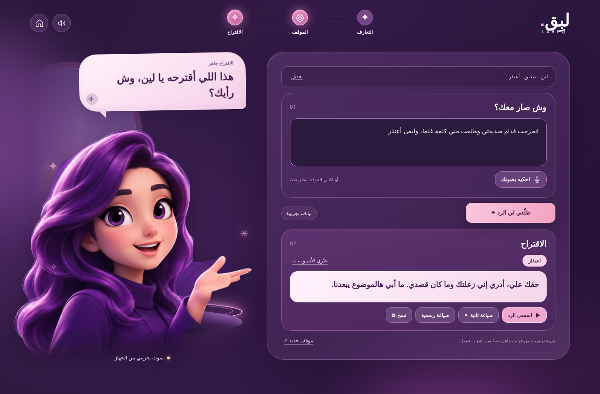
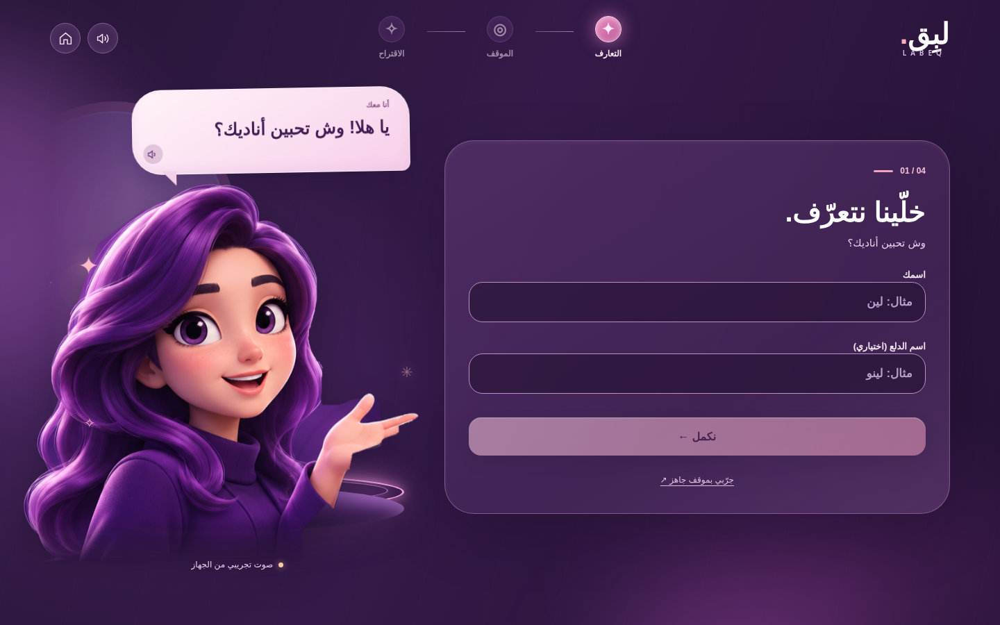
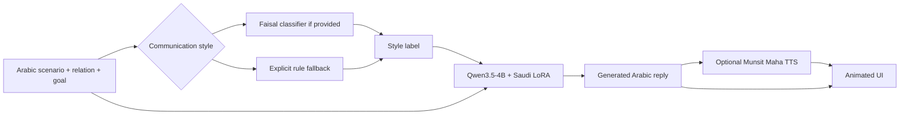

# LABEQ · لبِق

**An Arabic NLP communication assistant with an animated, Saudi-inspired user experience.**

[](#tech-stack) [](#features) [](#model-architecture)

> **Portfolio status:** Functional interactive website and local/Colab model integration code. A public, backend-free UI demo is included under [`docs/`](docs/). The hosted demo, if published to GitHub Pages, uses illustrative templates; it does **not** run the trained model or Maha TTS.



## What it does

LABEQ helps users decide **how to respond** in everyday Saudi Arabic communication. The experience asks for a name, preferred form of address, relationship, and communication goal. It then takes a user-written or dictated scenario and proposes an appropriate communication style and an editable/copiable reply.

### Features

- **Contextual flow:** name → relationship → goal → scenario and response on one screen.
- **Five styles:** polite, firm, diplomatic, apology, clarification.
- **Interactive 2.5D character:** idle motion, blinking, expressions and mouth movement. This is an illustrated layered animation, **not a rigged 3D model**.
- **Saudi voice option:** Munsit *Maha* voice through a server-side TTS integration when personally configured; browser voice may be used as fallback.
- **Speech input option:** browser speech recognition or provider-dependent transcription.
- **Actual generation (local/private mode):** Qwen3.5-4B + an externally supplied Saudi LoRA adapter.
- **Style selection:** Faisal model route is optional in the Colab research workflow; the published Mac local path clearly identifies its **rule-based fallback**. No trained Faisal adapter is bundled here.

## Screenshots

| Interactive onboarding | Communication suggestion |
| :---: | :---: |
|  |  |

## Try the interface

### Option A — public UI demo (no GPU)

Host the [`docs/`](docs/) folder with **GitHub Pages**: **Settings → Pages → Deploy from a branch → `main` → `/docs` → Save**.

The demo runs the original interaction flow, showing **sample template replies** only. It is honest about model/voice limitations and does not request API keys. Open `docs/index.html` locally to preview the page, or serve it with `python3 -m http.server 8080 --directory docs` and visit http://127.0.0.1:8080.

### Option B — backend website (requires an external AI service)

```bash
python3 -m venv .venv
source .venv/bin/activate
python -m pip install -r requirements.txt
cp .env.example .env
# Fill LABEQ_MODEL_API_URL and LABEQ_MODEL_API_KEY in .env
# Optionally configure MUNSIT_API_KEY and MUNSIT_VOICE_ID.
bash run_mac.sh
```

The backend expects a compatible inference API with `POST /v1/reply` and `GET /health` (see [`model_bridge.py`](model_bridge.py) and [`labeq_api.py`](labeq_api.py)). Do not expose inference keys in frontend JavaScript. If the model is not configured, the website reports an unavailable model rather than claiming a real response.

### Option C — local Apple Silicon inference (experimental)

Requirements: Apple Silicon, Python, MLX-VLM and the **user-provided Saudi LoRA adapter ZIP**. The model weights and adapter are *not* in this public repository.

```bash
# Put LABEQ_Saudi_LoRA_Backup.zip in this directory (untracked / gitignored).
bash prepare_local.sh
# In terminal A:
bash start_local_model.sh
# In terminal B:
bash run_mac.sh
```

`prepare_local.sh` converts the PEFT adapter into the layout used by MLX, writes a private API key to ignored local files and sets the web backend to local port 7862. Loading and generation should be tested **on the target Apple Silicon machine**. The local server uses async FastAPI startup and inference handlers to avoid a known MLX thread/stream mismatch. Hardware compatibility and response quality are **not guaranteed by this repository**.

## Model architecture



The main notebook documents an integrated experiment and an API that reuses a loaded model. The inference workflow should not be confused with proof of Faisal fine-tuning: **no verified accuracy/F1/confusion matrix or trained Faisal weights are published here**. Source notebooks are kept in [`notebooks/`](notebooks/) with saved outputs removed. See [model notes](MODEL_CARD.md) for the exact scope of the adapter metadata and evaluation limitations.

## Tech stack

**Frontend:** JavaScript, HTML, CSS, Canvas 2.5D animation, RTL Arabic UX and optional browser speech features. **Backend:** Python, FastAPI, Uvicorn, HTTPX. **ML research:** PyTorch/Transformers/PEFT/LoRA, Qwen3.5-4B, optional Faisal, Google Colab, MLX-VLM for local Apple Silicon experiments. **Speech:** Munsit API (Maha voice) when credentials are provided.

## Repository layout

```text
LABEQ/
├── README.md / README_AR.md
├── app.py / app.js / index.html / styles.css / character2d.js
├── assets/                 # approved LABEQ character illustrations
├── model_bridge.py         # FastAPI ↔ inference API
├── local_mlx_server.py     # Mac backup inference (model+adapter required)
├── convert_peft_to_mlx.py
├── labeq_engine.py / labeq_api.py / labeq_v4_core.py
├── notebooks/              # sanitized Colab notebooks (no cell outputs)
├── screenshots/            # visual showcase
├── docs/                   # GitHub Pages static demo
├── .env.example / .gitignore / SECURITY.md
└── prepare_local.sh / start_local_model.sh / run_mac.sh
```

## Honest limitations

- GitHub Pages is **frontend-only**, not an always-on GPU backend. A full live AI demo requires hosted inference or a running local/Colab backend.
- The uploaded LoRA weights are intentionally excluded from the public repo. Models and provider licenses are separate from this code.
- The UI uses animated **2.5D artwork**, not a true 3D GLB/rigged avatar. Lip sync is approximate.
- Qualitative examples in notebooks should not be presented as statistically validated performance. Do not fabricate before/after model scores.
- `scenarios.csv` and Faisal's trained adapter are not included in this public export; obtaining them is required for an independently reproducible classifier fine-tuning benchmark.

## Responsible use

Suggestions are editable, not authoritative. Users should review replies before sending, especially in sensitive interpersonal situations. Avoid submitting personal or confidential content to third-party voice/model providers without permission.

## Artwork and licensing

Source code is available under [`LICENSE-CODE`](LICENSE-CODE). The character illustrations in `assets/`, `docs/assets/`, and screenshots are **not covered by the code license**. External model, typeface and voice providers have their own terms. No Munsit voice files or service keys are distributed in this repository.

---

*LABEQ is an independent prototype demonstrating Arabic-centric product design, transformer/LoRA integration, and an interactive speech-enabled interface.*
