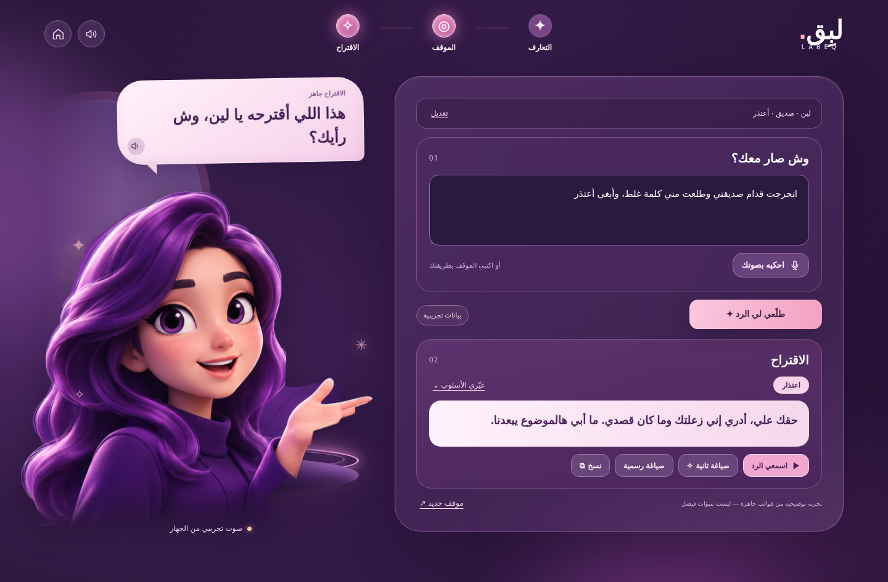

# لبِق (LABEQ) — مساعد تواصل عربي تفاعلي

مشروع يجمع بين واجهة عربية تفاعلية وشخصية موف متحركة، وتصنيف أسلوب الحديث (اختياري) وتوليد ردود باللهجة السعودية بواسطة Qwen3.5-4B مع Saudi LoRA عندما يكون خادم المودل متصلًا.



## التجربة المتاحة للعرض

مجلد `docs/` نسخة موقع للعرض على **GitHub Pages** بلا سيرفر أو GPU. تُظهر التعارف، العلاقة، الهدف، كتابة موقف، واقتراح ردود توضيحية بالقوالب. **هي ليست استدلالًا من المودل**، والصوت الاختياري فيها من المتصفح وليس «مها».

لنشرها: ارفعي الملفات إلى مستودع GitHub، ثم Settings → Pages → Deploy from a branch → `main` → `/docs` → Save.

## تشغيل الموقع مع مودل حقيقي

```bash
python3 -m venv .venv
source .venv/bin/activate
python -m pip install -r requirements.txt
cp .env.example .env
# ضعي رابط API والمفتاح الخاصين بك في .env
bash run_mac.sh
```

يستخدم الموقع `model_bridge.py` لإرسال الموقف والعلاقة والهدف إلى `POST /v1/reply` ويعرض ردود المودل الفعلية. إذا فشل المودل فلا يدّعي أن الرد نموذج حقيقي. صوت مها يحتاج مفتاح منصت خاصًا يُحفظ بالخادم فقط.

## نسخة الماك (MLX)

إذا توفر لديك ملف أوزان LoRA الأصلي، انسخي `LABEQ_Saudi_LoRA_Backup.zip` إلى مجلد المشروع (يبقى خارج Git)، ثم:

```bash
bash prepare_local.sh
bash start_local_model.sh
```

في Terminal آخر `bash run_mac.sh`. هذا المسار يحتاج Apple Silicon واختبار توافق عملي؛ نجاح تحميل الأوزان وحده لا يثبت نجاح التوليد. مصنّف فيصل المدرّب غير مضمن هنا، والنسخة المحلية تستخدم قواعد صريحة كبديل.

## هيكل المشروع

- `app.py` و`model_bridge.py`: الويب والربط بالمودل.
- `app.js` و`character2d.js` و`styles.css`: الواجهة والحركة.
- `local_mlx_server.py`: خادم الاستدلال المحلي الاختباري.
- `notebooks/`: دفاتر Colab مع إزالة مخرجات التنفيذ.
- `screenshots/`: صور العرض.
- `docs/`: نسخة GitHub Pages التوضيحية.
- `.env.example`: أمثلة إعدادات فقط، بدون مفاتيح حقيقية.

## حدود المشروع

الموقع قابل للعرض لكن GitHub Pages لا يشغّل Transformers أو LoRA أو صوت مها من الخادم. أوزان التدريب وبيانات `scenarios.csv` وAdapter فيصل المخصص غير مرفقة بالمستودع، ولا نعرض أرقام أداء غير موثّقة. الشخصية 2.5D متحركة وليست GLB ثلاثية أبعاد حقيقية.

**تنبيه:** راجعي الرسالة المقترحة قبل إرسالها، ولا تدخلي معلومات خاصة في خدمات صوتية خارجية دون موافقة.
