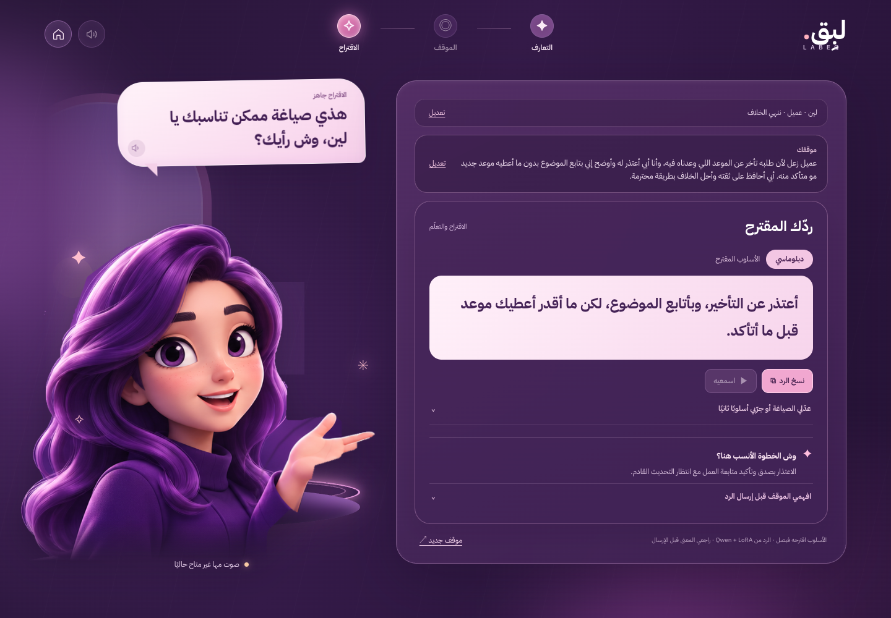

# Saudi register repair

The November 21, 2026 repair keeps the incumbent pilot adapter and actual Faisal routing. It changes inference guidance and bounded language checks. The completed v2 checkpoint remains preserved, with its original training results and selection limitations.

## What changed

Faisal's communication actions, such as diplomatic or apology, are now separate from the LoRA's trained writing labels, such as عفوي, واضح, and مهني. Professional situations retain respectful Saudi wording. They no longer automatically imply formal MSA.

The generation policy is shorter and uses Saudi phrasing. Full example conversations were removed after development checks showed unrelated example facts could enter new drafts. Generated coaching is displayed separately and is not injected as a source of facts into the reply.

A narrow surface editor converts common formal constructions while preserving negation, tense, quoted text, numbers, and the original facts. It does not create a complete situation reply. The API returns draft_before_register_normalization and register_normalization so developers can inspect the model's draft and the exact edits. An explicit Fusha request bypasses the dialect edits.

Concrete checks cover omitted follow-up, apology instructions accidentally addressed to the user, confused clarification questions, recurring boundaries, and specific model-review concerns about invented commitments. Broad model opinions about style remain advisory rather than automatically destroying a grounded first draft.

## Actual customer check

The same public situation, relationship عميل, and goal ننهي الخلاف produced:

Before:

> أعتذر عن التأخير، وما أردت أن أعطيكم موعدًا قبل ما يكون واضحًا.

After:

> أعتذر عن التأخير، وبأتابع الموضوع، لكن ما أقدر أعطيك موعد قبل ما أتأكد.

The final call returned router_source=faisal and reply_source=qwen_lora_generated. It kept the original pilot revision db2cf3390e5d163a58309df949aef58acb7bbd9a. The model itself generated the simpler wording and all three requested actions. The recorded surface edit changed وأتابع to وبأتابع because the user explicitly requested follow-up.

[Saved requests, responses, and screenshot hash](saudi-register-results.json) distinguish model generation from the bounded surface edits. The screenshot was saved directly from the actual HTTPS application through Chrome. The connected HF login was used for its GPU quota; no credentials appear in the record.

## Verification and limits

Public checks also exercised friendship misunderstanding and workplace clarification. The friendship reply became more conversational but still received a model-review concern. The first clarification output contained a speaker/addressee error; a concrete guard then exposed it as needing review. A tested narrow grammatical repair converts that reflexive request into an impersonal clarification request. This is recorded separately from model generation. Language and intent still require review. Sparse phrase diagnostics and a small regression set are not a Saudi dialect accuracy benchmark, and there are no independent human reviewers yet.

The CPU suite covers the meaning checks, negation/tense/quotation safeguards, transparent response metadata, and lossless conversion of the preserved MLX adapter. The MLX-to-PEFT utility verifies all 256 real tensors by exact transpose roundtrip and sampled delta equivalence, without retraining or overwriting the original checkpoint. That conversion does not itself authorize a change of the deployed adapter.

Ordinary short requests reserve 20 seconds of shared GPU time; longer contexts reserve 30 seconds. Queue waiting and account quota still apply. Maha's original voice configuration, artwork, playback and lip-sync integration remain preserved and speech remains inactive.

The last additional live repeat after the narrow clarification repair was blocked by the free account quota (30 seconds requested, 24 seconds remaining). The rule itself passed CPU regression tests; this later live repeat is not reported as successful. The previously captured real public customer response remains the before/after evidence. No paid hardware, credits, or subscription was activated.
